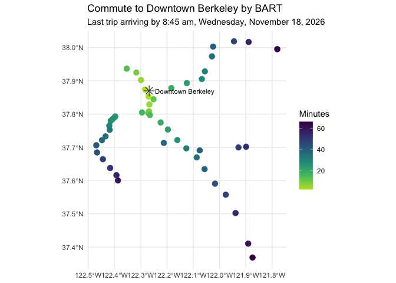
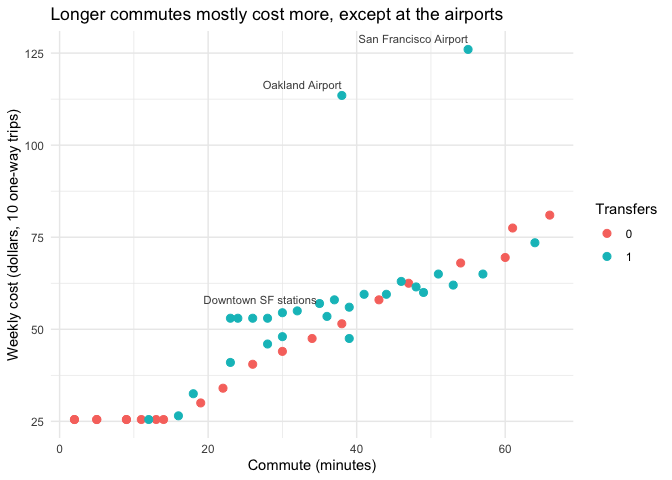

# bartcommute
Tsion-Aduesa Smart

<!--
About this file
&#10;This file renders to README.md, your repo's front page on GitHub. Render it
with the Preview button (or `quarto render project.qmd`), then commit and
push project.qmd, README.md, and man/figures/ (your plots). Change `title`
to your package's name, and leave the rest of the YAML as it is.
&#10;Fill in the five sections below as Part 5 of the assignment describes.
Give each plot's chunk a `fig-cap`: it becomes the plot's alt text.
&#10;The setup chunk loads your package with load_all(), so the README uses
your latest code. Load your other packages there too.
&#10;The README must render without the API: offline, and without a key. Your
analysis uses the data set you stored in Part 3. For anything that calls
the API, and for test() and check(), run it at the console, show the code
with `eval: false`, and paste the output below it in a plain code block.
&#10;Never put an API key in this file. Comments like this one don't show up
on GitHub.
-->

## Overview

bartcommute wraps the [BART
API](https://api.bart.gov/docs/overview/index.aspx) so you can look up
BART stations and plan trips from R. Many Berkeley students live farther
out and ride BART to Downtown Berkeley, so the package is built around
one question:

> Which BART stations could you live near and still make a 9:00 am class
> on campus, and what would the commute cost you each week?

It has two functions:

- `bart_stations()` returns every BART station with its city, county,
  and coordinates.
- `bart_trip()` finds the last trip from a station that arrives by a
  given time (by default, Downtown Berkeley by 8:45 am, 15 minutes
  before a 9:00 class) and returns its departure and arrival times,
  length, Clipper fare, and number of transfers.

The package also includes `commutes`, a data set of that trip from every
station, which the analysis below uses.

## Installation

bartcommute isn’t on CRAN. Install it from GitHub with:

``` r
# install.packages("remotes")
remotes::install_github("berkeley-stat133-projects/Project5-Tsion-AduesaSmart")
```

You don’t need to set up a key: both functions default to BART’s public
key. To use your own, register at
<https://api.bart.gov/api/register.aspx> and pass it as `key`.

## Usage

`bart_stations()` gives one row per station:

``` r
library(bartcommute)
bart_stations()
```

    # A tibble: 50 × 6
       abbr  name                         city          county         lat   lon
       <chr> <chr>                        <chr>         <chr>        <dbl> <dbl>
     1 12TH  12th St./Oakland City Center Oakland       alameda       37.8 -122.
     2 16TH  16th St./Mission             San Francisco sanfrancisco  37.8 -122.
     3 19TH  19th St./Oakland             Oakland       alameda       37.8 -122.
     4 24TH  24th St./Mission             San Francisco sanfrancisco  37.8 -122.
     5 ANTC  Antioch                      Antioch       Contra Costa  38.0 -122.
     6 ASHB  Ashby                        Berkeley      alameda       37.9 -122.
     7 BALB  Balboa Park                  San Francisco sanfrancisco  37.7 -122.
     8 BAYF  Bay Fair                     San Leandro   alameda       37.7 -122.
     9 BERY  Berryessa/North San Jose     San Jose      Santa Clara   37.4 -122.
    10 CAST  Castro Valley                Castro Valley alameda       37.7 -122.
    # ℹ 40 more rows

`bart_trip()` plans one trip. Millbrae to Downtown Berkeley, arriving by
8:45 am on Wednesday, November 18, 2026:

``` r
bart_trip("MLBR")
```

    # A tibble: 1 × 7
      orig  dest  depart              arrive              minutes  fare transfers
      <chr> <chr> <dttm>              <dttm>                <dbl> <dbl>     <int>
    1 MLBR  DBRK  2026-11-18 07:31:00 2026-11-18 08:31:00      60  6.95         0

Its arguments change the trip. For example, Dublin/Pleasanton (which
needs a transfer) arriving by 10:00 am instead:

``` r
bart_trip("DUBL", arrive_by = "10:00am")
```

    # A tibble: 1 × 7
      orig  dest  depart              arrive              minutes  fare transfers
      <chr> <chr> <dttm>              <dttm>                <dbl> <dbl>     <int>
    1 DUBL  DBRK  2026-11-18 08:50:00 2026-11-18 09:43:00      53   6.2         1

The `commutes` data set holds that trip from every station, built by
calling `bart_trip()` once per station:

``` r
head(commutes)
```

    # A tibble: 6 × 12
      abbr  name                  city  county   lat   lon dest  depart             
      <chr> <chr>                 <chr> <chr>  <dbl> <dbl> <chr> <dttm>             
    1 12TH  12th St./Oakland Cit… Oakl… alame…  37.8 -122. DBRK  2026-11-18 08:32:00
    2 16TH  16th St./Mission      San … sanfr…  37.8 -122. DBRK  2026-11-18 08:13:00
    3 19TH  19th St./Oakland      Oakl… alame…  37.8 -122. DBRK  2026-11-18 08:34:00
    4 24TH  24th St./Mission      San … sanfr…  37.8 -122. DBRK  2026-11-18 08:11:00
    5 ANTC  Antioch               Anti… Contr…  38.0 -122. DBRK  2026-11-18 07:27:00
    6 ASHB  Ashby                 Berk… alame…  37.9 -122. DBRK  2026-11-18 08:41:00
    # ℹ 4 more variables: arrive <dttm>, minutes <dbl>, fare <dbl>, transfers <int>

## Analysis

``` r
# Weekly cost: a round trip, five days a week.
# Drop Downtown Berkeley itself, which has no commute.
commutes <- commutes |>
  filter(abbr != "DBRK") |>
  mutate(weekly_cost = fare * 2 * 5)
```

### How long is the commute from each station?

``` r
commutes_sf <- st_as_sf(commutes, coords = c("lon", "lat"), crs = 4326)

ggplot(commutes_sf) +
  geom_sf(aes(color = minutes), size = 3) +
  scale_color_viridis_c(direction = -1, end = 0.9) +
  annotate("point", x = -122.268, y = 37.870, shape = 8, size = 4) +
  annotate("text", x = -122.268, y = 37.870, label = "Downtown Berkeley",
           hjust = -0.1, size = 3) +
  labs(
    title = "Commute to Downtown Berkeley by BART",
    subtitle = "Last trip arriving by 8:45 am, Wednesday, November 18, 2026",
    x = NULL, y = NULL,
    color = "Minutes"
  ) +
  theme_minimal()
```

<div id="fig-map">



Figure 1: Map of BART stations colored by the length of the trip that
reaches Downtown Berkeley by 8:45 am. Stations closest to Berkeley have
the shortest trips; trips grow longer toward the ends of each line.

</div>

Commute time grows steadily outward from Berkeley along each line.
Stations in Berkeley, Oakland, and El Cerrito are within about 15
minutes, while downtown San Francisco, Walnut Creek, and Bay Fair all
land around 25–30 minutes, and the ends of every line (Antioch,
Millbrae, Berryessa) take close to an hour.

Stations within 30 minutes of Downtown Berkeley:

``` r
commutes |>
  filter(minutes <= 30) |>
  arrange(minutes) |>
  select(Station = name, City = city, Minutes = minutes,
         `Weekly cost ($)` = weekly_cost, Transfers = transfers) |>
  knitr::kable()
```

<div id="tbl-30min">

Table 1

<div class="cell-output-display">

| Station | City | Minutes | Weekly cost (\$) | Transfers |
|:---|:---|---:|---:|---:|
| Ashby | Berkeley | 2 | 25.5 | 0 |
| North Berkeley | Berkeley | 2 | 25.5 | 0 |
| El Cerrito Plaza | El Cerrito | 5 | 25.5 | 0 |
| MacArthur | Oakland | 5 | 25.5 | 0 |
| 19th St./Oakland | Oakland | 9 | 25.5 | 0 |
| El Cerrito del Norte | El Cerrito | 9 | 25.5 | 0 |
| 12th St./Oakland City Center | Oakland | 11 | 25.5 | 0 |
| Rockridge | Oakland | 12 | 25.5 | 1 |
| Richmond | Richmond | 13 | 25.5 | 0 |
| Lake Merritt | Oakland | 14 | 25.5 | 0 |
| West Oakland | Oakland | 16 | 26.5 | 1 |
| Orinda | Orinda | 18 | 32.5 | 1 |
| Fruitvale | Oakland | 19 | 30.0 | 0 |
| Coliseum | Oakland | 22 | 34.0 | 0 |
| Embarcadero | San Francisco | 23 | 53.0 | 1 |
| Lafayette | Lafayette | 23 | 41.0 | 1 |
| Montgomery St. | San Francisco | 24 | 53.0 | 1 |
| Powell St. | San Francisco | 26 | 53.0 | 1 |
| San Leandro | San Leandro | 26 | 40.5 | 0 |
| Civic Center/UN Plaza | San Francisco | 28 | 53.0 | 1 |
| Walnut Creek | Walnut Creek | 28 | 46.0 | 1 |
| 16th St./Mission | San Francisco | 30 | 54.5 | 1 |
| Bay Fair | San Leandro | 30 | 44.0 | 0 |
| Pleasant Hill/Contra Costa Centre | Walnut Creek | 30 | 48.0 | 1 |

</div>

</div>

### What does the commute cost?

``` r
airports <- commutes |>
  filter(grepl("Airport", name)) |>
  mutate(label = sub(" International Airport.*", " Airport", name))

ggplot(commutes, aes(minutes, weekly_cost, color = factor(transfers))) +
  geom_point(size = 2.5) +
  geom_text(data = airports, aes(label = label), vjust = -0.9,
            hjust = "inward", size = 3, color = "gray30") +
  annotate("text", x = 27, y = 58, label = "Downtown SF stations",
           size = 3, color = "gray30") +
  labs(
    title = "Longer commutes mostly cost more, except at the airports",
    x = "Commute (minutes)",
    y = "Weekly cost (dollars, 10 one-way trips)",
    color = "Transfers"
  ) +
  theme_minimal()
```

<div id="fig-cost">



Figure 2: Scatter plot of commute time against weekly cost for each BART
station, colored by number of transfers. Cost mostly rises with time;
the two airport stations and the downtown San Francisco stations cost
more than their trip length predicts.

</div>

The stations that break the pattern, next to East Bay stations with
similar trip times:

``` r
commutes |>
  filter(grepl("Airport", name) |
           abbr %in% c("EMBR", "POWL", "LAFY", "SANL")) |>
  arrange(desc(weekly_cost)) |>
    select(Station = name, Minutes = minutes, `One-way fare (USD)` = fare,
         `Weekly cost (USD)` = weekly_cost, Transfers = transfers) |>
  knitr::kable()
```

<div id="tbl-outliers">

Table 2

<div class="cell-output-display">

| Station | Minutes | One-way fare (USD) | Weekly cost (USD) | Transfers |
|:---|---:|---:|---:|---:|
| San Francisco International Airport (SFO) | 55 | 12.60 | 126.0 | 1 |
| Oakland International Airport (OAK) | 38 | 11.35 | 113.5 | 1 |
| Embarcadero | 23 | 5.30 | 53.0 | 1 |
| Powell St. | 26 | 5.30 | 53.0 | 1 |
| Lafayette | 23 | 4.10 | 41.0 | 1 |
| San Leandro | 26 | 4.05 | 40.5 | 0 |

</div>

</div>

Two groups break the pattern. The airport stations cost far more than
their trip length predicts. A trip from Oakland Airport costs \$7.95
more than one from Coliseum, the station right before it, because BART
charges a premium fare for its Oakland Airport connector. A trip from
SFO costs \$5.65 more than one from Millbrae, even though Millbrae is
farther away, because of BART’s SFO surcharge. The downtown San
Francisco stations sit above East Bay stations with the same trip time:
Embarcadero and Lafayette are both 23 minutes, but Embarcadero costs
\$1.20 more each way because trips through the Transbay Tube pay a
surcharge (see [BART’s fares](https://www.bart.gov/tickets)). Transfers,
on the other hand, don’t affect cost: stations with and without a
transfer are mixed together all along the trend, since BART charges by
distance, not by how many trains you ride.

### Where would I live?

I’d live near El Cerrito Plaza, MacArthur, or Richmond. All three cost
the minimum fare, \$25.50 a week, and need no transfers, so there’s no
connection to miss on the way to a 9:00 class. El Cerrito Plaza and
MacArthur are only 5 minutes from Downtown Berkeley. Richmond takes 13
minutes for the same price, and because it’s the end of the line, I’d
likely get a seat. I’d skip Rockridge even though it’s only 12 minutes,
because it requires a transfer at MacArthur, and I’d skip San Francisco:
its 23–30 minute trips cost about \$53 a week because of the Transbay
crossing, roughly twice as much as East Bay stations with similar times.

**Limitation:** Each row is the last train that arrives by 8:45 am on a
single Wednesday, so the data have no buffer for delays: if that train
runs late, you miss class. The minutes also count only time on the
train, not the walk to the station or from Downtown Berkeley to the
classroom.

## Testing

The tests are in `tests/testthat/`. Because BART’s schedule and fares
change, they test what the functions promise (the shape and types of
their output, and rules every trip follows), not today’s exact values.
Tests that call the API are skipped when you’re offline.

**Typical inputs.** Test that…

- `bart_stations()` returns the six columns `abbr`, `name`, `city`,
  `county`, `lat`, `lon`, in order, with numeric coordinates
- `bart_trip()` returns one row with the seven columns `orig`, `dest`,
  `depart`, `arrive`, `minutes`, `fare`, `transfers`, in order
- trips arrive by `arrive_by` (checked for Millbrae, Dublin/Pleasanton,
  and Richmond)
- `minutes` matches the time between `depart` and `arrive`
- fares and trip lengths are positive

**Edge cases.** Test that…

- a trip from Millbrae has no transfers
- a trip from Dublin/Pleasanton has one transfer

**Errors.** Test that…

- `bart_trip()` stops with a clear message when `orig` isn’t a single
  string, like `bart_trip(c("MLBR", "DUBL"))`
- a station that doesn’t exist, like `bart_trip("XXXX")`, gives an error

**Bug test.** A classmate reported that `bart_trip()` stopped at
Downtown Berkeley with HTTP 400 Bad Request. Sending the Part 1 request
with `orig=DBRK` showed why: the trip starts and ends at the same
station, and BART refuses it
({“?xml”:{“@version”:“1.0”,“@encoding”:“utf-8”},“root”:{“message”:{“error”:{“text”:“Invalid
dest”,“details”:“The dest station parameter DBRK must be different from
the orig station parameter.”}}}}). Since living near Downtown Berkeley
really does mean no commute, I decided `bart_trip("DBRK")` should return
a zero commute: 0 minutes, \$0, and no transfers. I first wrote the test
“a trip from Downtown Berkeley to itself is a zero commute,” which
failed with BART’s HTTP 400. Then I fixed `bart_trip()` to check whether
`orig` and `dest` are the same and, if so, return that row without
sending a request. The test now passes. It also checks that the times
aren’t `NA`, since two `NA`s would otherwise pass as equal.

``` r
devtools::test()
```

    ══ Results ═════════════════════════════════════════════════════════════════════
    Duration: 4.7 s

    [ FAIL 0 | WARN 0 | SKIP 0 | PASS 19 ]

``` r
devtools::check()
```

    ── R CMD check results ────────────────────────────────── bartcommute 0.1.0 ────
    Duration: 13.2s

    0 errors ✔ | 0 warnings ✔ | 0 notes ✔
